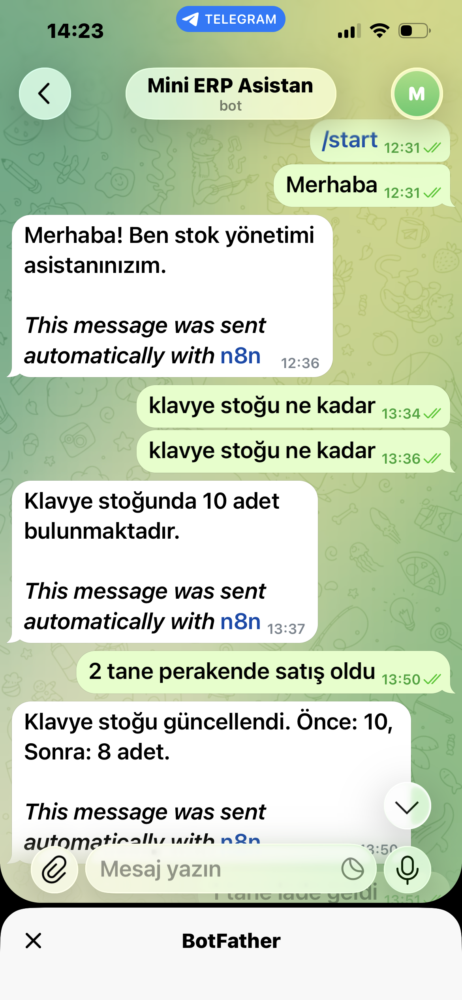
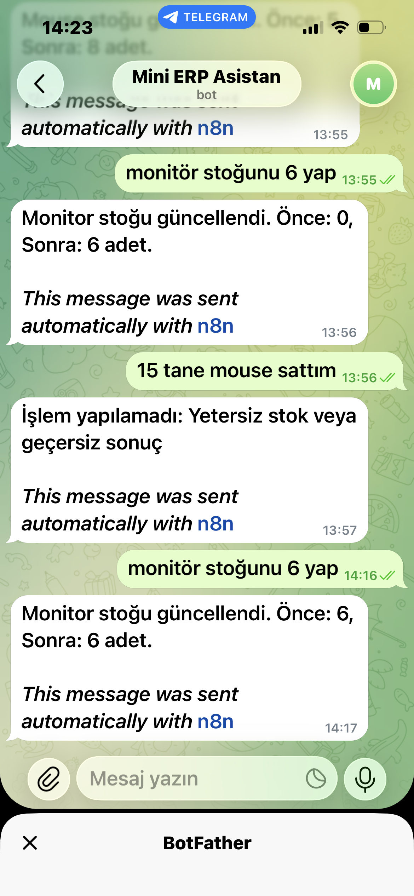
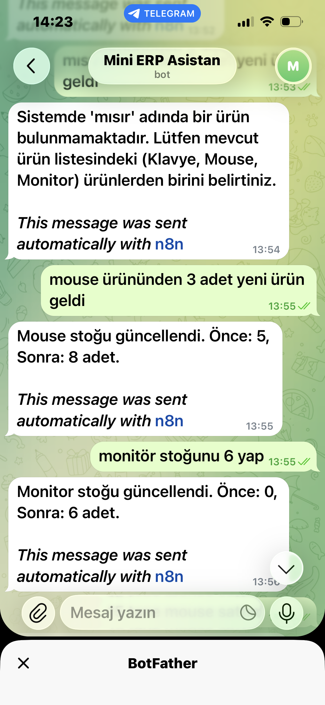
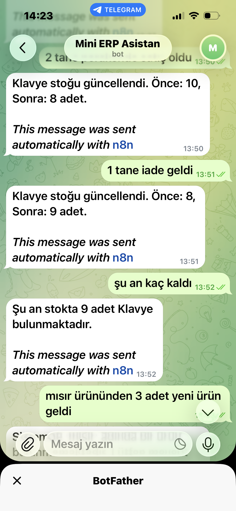

# Mini ERP – Telegram AI Stok Asistanı

Telegram üzerinden doğal dilde stok yönetimi yapılmasını sağlayan, yapay zekâ destekli mini ERP otomasyon projesi.

## Proje Hakkında

Bu proje, kullanıcıların Telegram botuna mesaj göndererek ürün stoklarını sorgulamasını ve güncellemesini sağlamak amacıyla geliştirilmiştir.

Google Gemini ile kullanıcı mesajları analiz edilir, n8n ile iş akışı yönetilir ve Google Apps Script API aracılığıyla Google Sheets üzerindeki stok verileri güncellenir.

## Kullanılan Teknolojiler

- **n8n:** İş akışı otomasyonu
- **Google Gemini:** Doğal dil işleme ve AI Agent
- **Telegram Bot API:** Kullanıcı etkileşimi
- **Google Apps Script (JavaScript):** HTTP API ve stok işlemleri
- **Google Sheets:** Veri depolama ve stok takibi
- **Docker:** n8n'in yerel ortamda çalıştırılması

## Özellikler

- Doğal dilde stok sorgulama
- Satış sonrası stok azaltma
- İade veya yeni ürün girişiyle stok artırma
- Stok miktarını güncelleme
- Stok hareketlerini kaydetme
- Önceki mesajları hatırlayarak bağlama uygun yanıt verme
- API anahtarıyla erişim kontrolü

## Sistem Mimarisi

`Telegram Bot → n8n → Gemini AI Agent → Google Apps Script API → Google Sheets`

## Proje Görselleri

Telegram botunun kullanım örnekleri:

  
  
  
  

## Not

Bu proje, AI Agent, API entegrasyonu ve iş akışı otomasyonu konularında pratik deneyim kazanmak amacıyla geliştirilmiş kişisel bir portföy çalışmasıdır.
